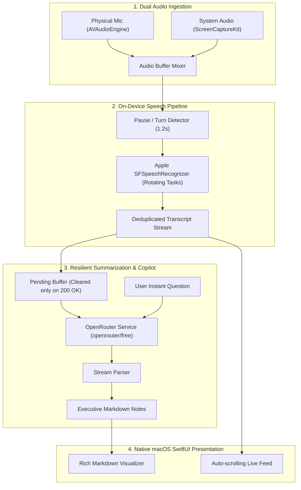

# LiveNotes vs. State-of-the-Art GitHub Meeting Assistants
## Deep Comparative Analysis, Bug Audit & Architectural Improvement Plan

---

### 1. Executive Summary

We conducted a deep comparative audit of **`LiveNotes` (macOS Native)** against the leading open-source GitHub meeting assistants and interview copilots referenced in this project:
- **`michaelwilhelmsen/humla`** (macOS, Tauri 2, Rust & Swift, dual audio capture, local RAG)
- **`DatanoiseTV/meeting-assistant`** (C++, whisper.cpp, real-time live copilot query, structured role personas)
- **`Zackriya-Solutions/meeting-minutes` / `Meetily`** (Rust, Whisper/Parakeet, offline local LLM summarization)
- **Claude Reference Architecture** (`docs/claude_full_assistant_message.md`, resilient batching, sliding window)

---

### 2. Feature & Architectural Comparison Matrix

| Dimension | **Our Current `LiveNotes`** | **`humla` (GitHub)** | **`meeting-assistant` (GitHub)** | **Claude Ref Spec** |
| :--- | :--- | :--- | :--- | :--- |
| **GUI Framework** | Pure Native SwiftUI / AppKit (~300 KB DMG) | Tauri 2 (Rust + Swift bridge) | C++ / ImGui Desktop | CLI / Terminal |
| **Audio Input** | Microphone only (`AVAudioEngine.inputNode`) | Dual (Microphone + System Audio) | Microphone + Virtual Sink | Mic via `sounddevice` |
| **STT Engine** | Apple `Speech.framework` (On-Device ANE) | Local Whisper & Cloud (Deepgram/Groq) | On-device `whisper.cpp` | Local `mlx-whisper` (16kHz) |
| **Summarization** | OpenRouter (`openrouter/free` streaming SSE) | Local Ollama / Anthropic / OpenAI | Local Ollama / OpenAI API | Gemini / OpenRouter SSE |
| **Batch Resilience** | ⚠️ Drops pending on network error | Retries on network failure | Queue-based streaming | Backoff retry, no loss |
| **Meeting History** | Files saved to disk, no in-app browser | SQLite / Local RAG database | Markdown files in vault | Timestamped folders |
| **Interactive Copilot**| Passive summarization only | Interactive RAG chat | Hotkey real-time Q&A (`Space`) | Passive streaming |
| **UI Rendering** | Plain `Text()` string view | Styled rich markdown | Structured card widgets | CLI streaming stdout |

---

### 3. Critical Bugs & Edge Cases Identified in Current Code

#### Bug A: Data Loss on Summarizer Failure (High Severity)
- **Location**: `LiveNotesMacApp/Sources/Core/OpenRouterService.swift#L106`
- **Mechanism**:
  ```swift
  let chunkToSummarize = pendingTranscripts.joined(separator: "\n")
  pendingTranscripts.removeAll() // ⚠️ Cleared BEFORE network call!
  isSummarizing = true
  Task { await requestOpenRouterStream(userPrompt: userPrompt) }
  ```
  If `requestOpenRouterStream` fails due to a network timeout, HTTP 429 rate limit, or invalid response, `pendingTranscripts` is already wiped. Those transcripts will **never** be included in any future summary cycle.
- **Fix**: Only remove items from `pendingTranscripts` after the streaming response finishes successfully (HTTP 200 and valid chunks received).

#### Bug B: Apple Speech Recognition 60-Second Task Limit
- **Mechanism**: `SFSpeechRecognitionTask` on macOS can silently stall or terminate after continuous audio buffers exceed Apple's internal audio limits without throwing a fatal error.
- **Fix**: Implement periodic recognition task rotation (seamlessly cycling the recognition request on speech pauses >= 1.5s or every 5 minutes) without restarting the audio engine.

#### Bug C: Raw Markdown Rendering in SwiftUI
- **Location**: `LiveNotesMacApp/Sources/App/App.swift#L250`
- **Mechanism**: `Text(summarizer.currentSummary)` renders headers (`## Decisions`) and lists (`- [ ]`) as literal plaintext characters rather than formatted headers and interactive bullet items.
- **Fix**: Use `LocalizedStringKey(summarizer.currentSummary)` or SwiftUI Markdown styling to render bold headings, italicized context, and bulleted decision points.

---

### 4. High-Impact Enhancements to Match & Surpass GitHub Apps

#### 1. System Audio Capture via `ScreenCaptureKit` (Meeting Call Transcription)
- **The Problem**: Currently, `LiveNotes` only records the physical microphone. In Zoom, Google Meet, or Microsoft Teams calls, it hears the user's voice, but **cannot hear remote participants speaking through system audio**!
- **The Solution**: On macOS 13.0+, Apple introduced native `ScreenCaptureKit` system audio streaming (`SCStream`). This requires **zero kernel extensions or virtual audio cables (no BlackHole needed)**. Capturing mic audio + system audio enables full bilateral meeting transcription.

#### 2. Interactive "Ask Copilot" Real-Time Query Bar
- Add a bottom query bar in the right pane:
  - Examples: *"What did John promise about the API deadline?"*, *"List all mentioned blockers."*
  - Uses the full accumulated transcript context and sends a quick one-shot query to `openrouter/free`.

#### 3. Meeting History & Search Drawer
- Add a collapsible left sidebar showing past meeting sessions from `~/Documents/LiveNotes`.
- Clicking a past session immediately loads its `transcript.txt` and `summary.md`.

#### 4. Resilient Exponential Backoff for OpenRouter
- If OpenRouter free tier is queued or temporarily returns 429, retry after `min(pow(2, attempt), 30)` seconds with pending transcript retention.

---

### 5. Architectural Improvement Roadmap


